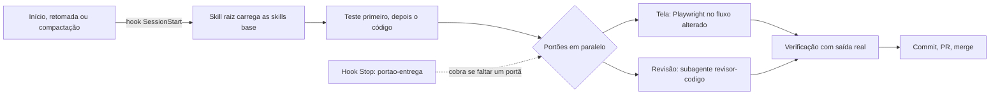

# agentes-padrao

Um padrão de trabalho para agentes de código (Claude Code, Codex, Cursor): quais skills usar em cada momento, dois portões obrigatórios antes de qualquer entrega e um mínimo de segurança. Tudo em português, pensado para quem usa IA no dia a dia e não quer abrir mão de teste, revisão e verificação.

## O problema

Agente de código tende a declarar "pronto" sem ter rodado nada, a pular revisão e a validar tela só lendo o diff. Este repositório transforma essas regras em coisas que o agente carrega sozinho no início da sessão e que um hook cobra no fim do turno.

## Como funciona



1. **Skill raiz** (`skills/padrao-agentes`): o hook `SessionStart` injeta o corpo dela em toda sessão. Ela manda carregar as skills base e define a ordem da entrega.
2. **Portão de tela**: tudo que é visual ou integrado no front é exercitado com Playwright no app rodando local, com evidência.
3. **Portão de revisão**: o subagente `revisor-codigo` recebe o diff e o requisito, nunca a conclusão de quem escreveu. Só lê e roda testes, não edita.
4. **Hook Stop** (`hooks/portao-entrega.js`): lê o transcript da sessão e segura o fim do turno, uma vez por leva de edições, se houve edição de código sem revisor depois ou edição de tela sem Playwright depois.

## Instalar ou atualizar

Requer `bash` e `node`.

```bash
git clone https://github.com/hugh514/agentes-padrao.git ~/projects/agentes-padrao
bash ~/projects/agentes-padrao/instalar.sh
```

O instalador é idempotente: depois de um `git pull`, rode de novo. Nos arquivos de regras (`CLAUDE.md`, `AGENTS.md`) ele só mexe no bloco entre `<!-- padrao-agentes:inicio -->` e `<!-- padrao-agentes:fim -->`.

**Atenção, ele também sobrescreve:**

- skills de mesmo nome nas pastas de skills (uma `brainstorming` sua seria substituída: faça backup antes);
- `~/.claude/agents/revisor-codigo.md` e `~/.claude/hooks/portao-entrega.js`;
- `~/.cursor/rules/padrao-agentes.mdc`;
- `~/.claude/settings.json`, onde acrescenta os hooks `SessionStart` e `Stop` (o arquivo é regravado com nova formatação).

| Ferramenta | Regras | Skills |
|---|---|---|
| Claude Code | `~/.claude/CLAUDE.md` | `~/.claude/skills` |
| Codex | `~/.codex/AGENTS.md` | `~/.codex/skills` |
| Cursor | `~/.cursor/rules/padrao-agentes.mdc` | `~/.cursor/skills` |
| Outros (skills CLI) | | `~/.agents/skills` |

Os hooks e o subagente revisor são específicos do Claude Code e vão para `~/.claude`.

## Conteúdo

| Caminho | O que é |
|---|---|
| `AGENTS.md` | O padrão: qual skill usar em cada momento, fluxo de entrega, segurança mínima e o que é proibido |
| `skills/padrao-agentes` | Skill raiz, injetada no início da sessão |
| `agents/revisor-codigo.md` | Subagente revisor independente |
| `hooks/portao-entrega.js` | Hook Stop dos dois portões (testes em `portao-entrega.test.js`) |
| `skills/codigo-seguro` | Checklist de segurança 2026: OWASP Top 10 2025, OWASP Agentic Top 10, slopsquatting |
| `skills/arquitetura-de-sistema` | Lente para decisão estrutural: ler ADRs e o que já existe, dono do dado, alternativa mínima |
| `skills/pesquisa-de-mercado` | Pesquisa que serve a uma decisão: ordem de fontes, três fontes para chamar de padrão, data em tudo |
| `skills/git-ptbr-commits-prs` | Commits, branches e PRs em português, e o que sobe versus o que fica local |
| `skills/` (fluxo e depuração) | Skills do superpowers e a `ponytail`, de terceiros (ver abaixo) |

## Testar o hook

```bash
node hooks/portao-entrega.test.js
```

## Créditos e licença

- Código e textos próprios: MIT, em `LICENSE`.
- As skills do [superpowers](https://github.com/obra/superpowers) e a [ponytail](https://github.com/DietrichGebert/ponytail) são de terceiros, também MIT, com pequenas adaptações descritas em `THIRD_PARTY_NOTICES.md`. As licenças completas estão em `THIRD_PARTY_NOTICES.md`.
- Referências de segurança: [OWASP Top 10:2025](https://owasp.org/Top10/2025/), OWASP Top 10 for Agentic Applications 2026 e a [nota da CSA sobre slopsquatting](https://labs.cloudsecurityalliance.org/research/csa-research-note-slopsquatting-ai-supply-chain-20260419-csa/).
